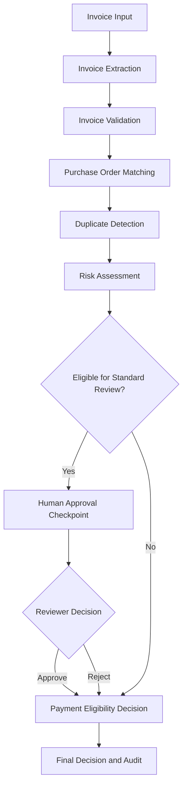
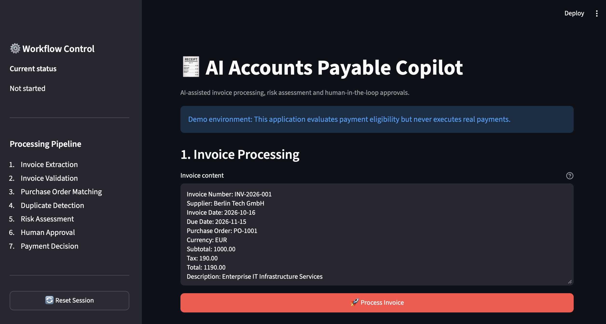
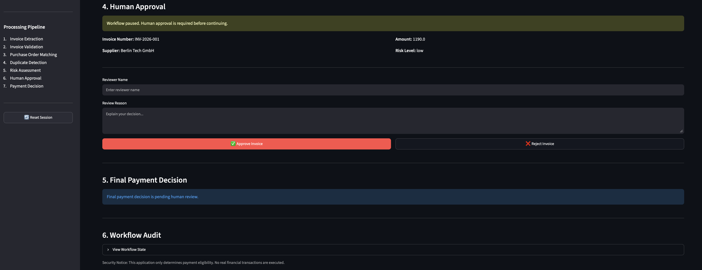
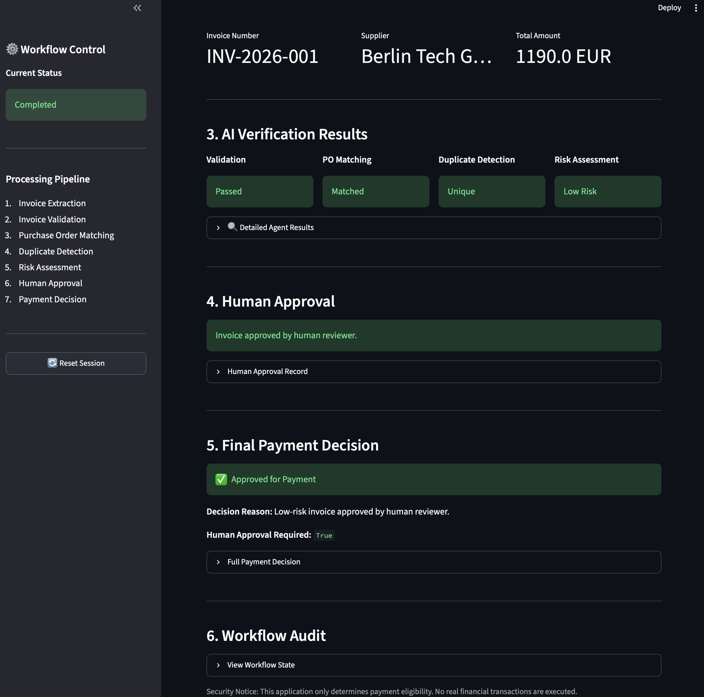

# 🧾 AI Accounts Payable Copilot

### Human-in-the-Loop Invoice Processing with LangGraph, Python & Streamlit

An AI-assisted Accounts Payable workflow designed to automate invoice verification, detect financial risks, and support controlled payment eligibility decisions through human oversight.

The application combines specialized processing agents, structured validation, risk assessment, and a LangGraph workflow with human approval checkpoints.

**This is a portfolio demonstration project. It does not initiate, authorize, or execute real financial transactions.**

---

## ✨ Key Features

- **Invoice Extraction:** Converts structured invoice text into validated invoice data.
- **Invoice Validation:** Checks required fields, financial consistency, and invoice dates.
- **Purchase Order Matching:** Compares invoice details against purchase order records.
- **Duplicate Detection:** Identifies potentially duplicated invoices.
- **Risk Assessment:** Evaluates invoice risks, including unusual amounts, duplicate records, purchase order mismatches, and changed bank details.
- **Human-in-the-Loop Approval:** Pauses processing until a reviewer approves or rejects an eligible invoice.
- **Payment Eligibility Decision:** Produces a final structured decision without executing payments.
- **Workflow Audit:** Displays workflow state and review records in the dashboard.
- **Automated Testing:** Includes unit tests for core invoice processing and decision logic.

## 🏗️ System Architecture



The workflow is orchestrated with **LangGraph**, using state transitions and checkpoint-based interruption to support human review.

## 🧠 Processing Components

| Component | Responsibility |
|---|---|
| Invoice Extraction Agent | Extract invoice fields from text |
| Invoice Validation Agent | Validate invoice completeness and financial values |
| PO Matching Agent | Compare invoices with purchase orders |
| Duplicate Detection Agent | Identify possible duplicate invoices |
| Risk Detection Agent | Assess financial and operational risk |
| Human Approval Node | Pause and resume processing after human review |
| Payment Decision Service | Determine final invoice payment eligibility |

## 🔐 Safety and Human Oversight

The system is designed with several safety controls:

- Human review before standard payment approval.
- Validation of reviewer responses.
- Invoice identity verification during approval.
- Protection against invalid invoices and duplicate records.
- Risk-based eligibility checks.
- Structured decision records.
- No integration with a real payment execution service.

A successful approval produces an `approved_for_payment` decision, which represents eligibility only—not an actual payment.

## 🖥️ Streamlit Dashboard

The interactive interface provides:

1. Invoice processing controls.
2. Invoice overview and financial details.
3. Validation, PO matching, duplicate detection, and risk results.
4. Human approval and rejection controls.
5. Final payment eligibility decisions.
6. Workflow audit and execution details.


### Application Screenshots

#### 1. Invoice Processing Dashboard

The dashboard displays invoice information, validation results,
purchase order matching, duplicate detection, and risk assessment.



#### 2. Human-in-the-Loop Approval

The workflow pauses for human review, allowing an authorized
reviewer to approve or reject an invoice.



#### 3. Final Payment Eligibility Decision

After human review, the system generates a structured payment
eligibility decision with an explanation and audit information.



> **Security Notice:** This application does not execute real payments.


## 🛠️ Technology Stack

| Technology | Purpose |
|---|---|
| Python 3.11 | Application development |
| LangGraph | Stateful workflow orchestration |
| Pydantic | Structured data models and validation |
| Streamlit | Interactive web dashboard |
| pytest | Automated testing |
| python-dotenv | Environment variable management |
| OpenAI-compatible SDK | Available for AI model integration |

The project requirements also include libraries for future extensions involving RAG, document processing, databases, visualization, and API services.

## 📁 Project Structure

```text
ai-accounts-payable-copilot/
├── app/
│   ├── agents/
│   │   ├── invoice_extraction_agent.py
│   │   ├── invoice_validation_agent.py
│   │   ├── po_matching_agent.py
│   │   ├── duplicate_detection_agent.py
│   │   └── risk_detection_agent.py
│   ├── graph/
│   │   ├── accounts_payable_graph.py
│   │   ├── human_approval.py
│   │   └── state.py
│   ├── models/
│   │   ├── invoice.py
│   │   ├── purchase_order.py
│   │   └── approval.py
│   └── services/
│       └── approval_service.py
├── data/
│   ├── invoices/
│   └── purchase_orders/
├── tests/
├── streamlit_app.py
├── requirements.txt
├── .env.example
├── .gitignore
└── README.md
```

## 🚀 Getting Started

### 1. Clone the repository

```bash
git clone https://github.com/YOUR_USERNAME/ai-accounts-payable-copilot.git
cd ai-accounts-payable-copilot
```

Replace `YOUR_USERNAME` with the actual GitHub account name after publishing the repository.

### 2. Create a virtual environment

```bash
python3.11 -m venv .venv
source .venv/bin/activate
```

On Windows:

```powershell
.venv\Scripts\activate
```

### 3. Install dependencies

```bash
python -m pip install -r requirements.txt
```

### 4. Configure environment variables

```bash
cp .env.example .env
```

If model-backed features are enabled, configure the required API credentials locally.

Never commit real API keys or secrets.

### 5. Start the application

```bash
python -m streamlit run streamlit_app.py
```

Open the local URL displayed in the terminal, typically:

`http://localhost:8501`

## 🧪 Testing

Run the automated test suite:

```bash
python -m pytest tests/ -v
```

**Latest verified result: 29 tests passed.**

The tests cover invoice models, validation, purchase order matching, duplicate detection, risk assessment, and payment decision logic.

Additional manual workflow tests cover human approval, rejection, interruption, and resumption.

## 🔄 Human Approval Workflow

1. The invoice is processed through the verification pipeline.
2. Eligible invoices reach the human approval checkpoint.
3. LangGraph interrupts execution and waits for a reviewer.
4. The reviewer submits an approval or rejection with review details.
5. The workflow resumes using the saved checkpoint.
6. The final payment eligibility decision is generated.

### Possible Final Decisions

| Status | Meaning |
|---|---|
| `approved_for_payment` | Invoice passed the applicable checks and human approval |
| `rejected` | Human reviewer rejected the invoice |
| `on_hold` | Invoice requires further review or failed a required check |

No decision triggers an actual payment.

## 🎯 Project Objectives

This project demonstrates practical experience with:

- Multi-component AI-assisted workflow design
- LangGraph orchestration
- Human-in-the-loop decision systems
- Financial document processing
- Structured data validation
- Risk-aware automation
- Stateful workflow execution
- Automated testing
- Streamlit application development

## 🗺️ Potential Future Improvements

- PDF invoice ingestion and OCR.
- Persistent checkpoint storage.
- Reviewer authentication and role-based permissions.
- Tamper-resistant audit logging.
- Retrieval-augmented policy verification.
- ERP and accounting system integrations.
- FastAPI endpoints.
- Docker-based deployment.
- CI/CD pipelines and integration tests.

## ⚠️ Disclaimer

This software is an educational and portfolio demonstration.

It is not intended for production financial operations without additional security controls, authentication, authorization, persistent audit records, regulatory review, and integration testing.

**No real payments are executed.**

---

Built to demonstrate AI-assisted financial workflows, human oversight, and reliable automation.